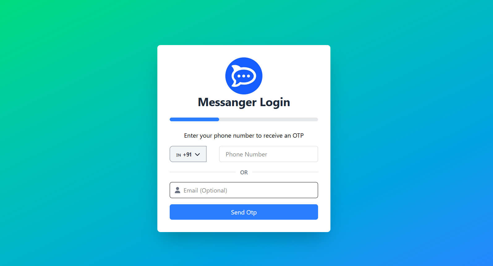
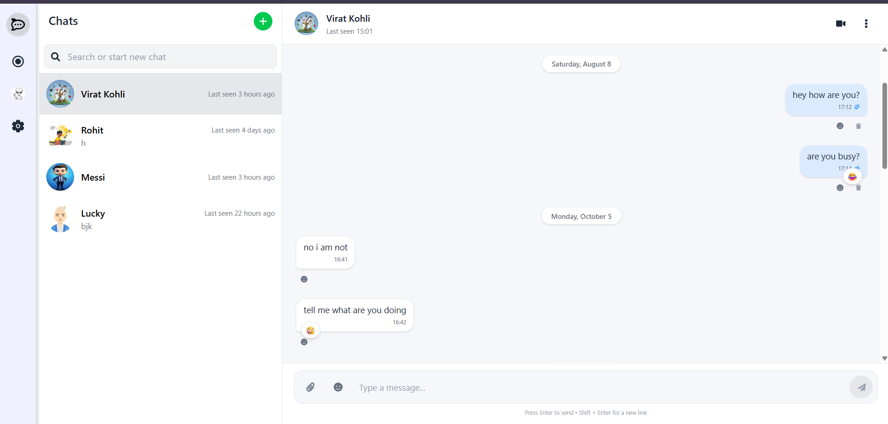
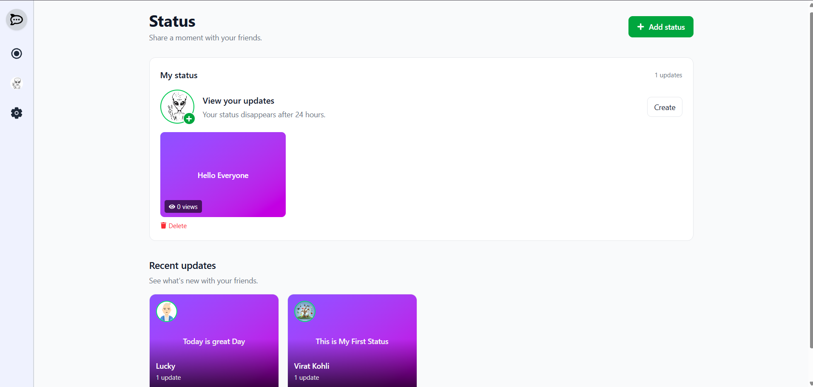

# 💬 Messangewr — Frontend

A real-time chat web app inspired by WhatsApp and Instagram DMs. Built with **React (Vite)** and connected to a **Node.js + Socket.IO** backend, it supports live messaging, OTP-based sign-up, typing indicators, read receipts, emoji reactions, and 24-hour disappearing statuses.

**🔗 Live demo:** [messangerbyamit.vercel.app](https://messangerbyamit.vercel.app/)
**⚙️ Backend repo:** [messangewr-apk-_backend](https://github.com/Amit14s/messangewr-apk-_backend)

---

## 📸 Screenshots

<!-- TODO: save your screenshots in a /screenshots folder using these exact names -->

| Login / OTP | Chat window | Status / Stories |
| :---: | :---: | :---: |
|  |  |  |

---

## ✨ Features

- **Real-time messaging** — instant delivery over Socket.IO, with messages persisted through the REST API
- **OTP authentication** — sign up and verify via email (Nodemailer) or SMS (Twilio); JWT session stored in an HTTP-only cookie
- **Online presence** — live online/offline status and last-seen time
- **Typing indicators** — shown while the other user types, and cleared automatically after a short timeout
- **Read receipts** — message status updates in real time (sent → delivered → read)
- **Emoji reactions** — add, change, or remove a reaction; updates appear for both users instantly
- **24-hour statuses** — post a status that expires after a day, and see who viewed it
- **Unread counters** — per-conversation unread message counts
- **Responsive UI** — works on desktop and mobile browsers

<!-- TODO: remove any feature above that is not in your UI, and add any I missed (image sharing, dark mode, search, etc.) -->

---

## 🛠 Tech Stack

| Layer | Technology |
| --- | --- |
| Framework | React |
| Build tool | Vite |
| Real-time | Socket.IO Client |
| Deployment | Vercel |

<!-- TODO: paste your package.json dependencies and I will complete this table (routing, state management, styling, HTTP client, icons, etc.) -->

---

## 🏗 How It Works

```
┌──────────────────┐   REST (auth, messages, status)   ┌──────────────────────┐
│  React Frontend  │ ────────────────────────────────▶ │  Express + MongoDB   │
│  (this repo)     │                                   │  (backend repo)      │
│                  │ ◀──────────────────────────────── │                      │
│                  │    Socket.IO (real-time events)   │  Socket.IO server    │
└──────────────────┘                                   └──────────────────────┘
```

- **REST API** handles sign-up, login, OTP verification, saving messages, fetching conversation history, and statuses.
- **Socket.IO** handles live events: message delivery, presence, typing, read receipts, and reactions.

### Socket events used by the client

| Event | Direction | Purpose |
| --- | --- | --- |
| `user_connected` | client → server | Register the logged-in user as online |
| `get_user_status` | client → server | Ask whether a user is online and their last seen time |
| `send_message` | client → server | Send a message to another user |
| `receive_message` | server → client | Deliver an incoming message |
| `message_read` | client → server | Mark messages as read |
| `message_status_update` | server → client | Update tick status on the sender's side |
| `typing_start` / `typing_stop` | client → server | Notify the other user about typing |
| `user_typing` | server → client | Show or hide the typing indicator |
| `add_reaction` | client → server | Add, change, or remove an emoji reaction |
| `reaction_update` | server → client | Refresh reactions on a message |
| `user_status` | server → client | Broadcast online/offline changes |

---

## 📁 Project Structure

```
messanger_apk-frontend/
├── public/            # Static assets
├── src/               # Application source
├── index.html         # App entry HTML
├── vite.config.js     # Vite configuration
├── vercel.json        # Vercel deployment config
├── eslint.config.js   # Linting rules
└── package.json
```

<!-- TODO: paste your src/ folder tree and I will expand this (components, pages, context, hooks, services...) -->

---

## 🚀 Getting Started

### Prerequisites

- Node.js v18 or later
- The [backend](https://github.com/Amit14s/messangewr-apk-_backend) running locally or deployed

### Installation

```bash
# 1. Clone the repository
git clone https://github.com/Amit14s/messanger_apk-frontend.git
cd messanger_apk-frontend

# 2. Install dependencies
npm install

# 3. Create a .env file (see below)

# 4. Start the dev server
npm run dev
```

### Environment variables

Create a `.env` file in the project root:

```env
VITE_API_URL=http://localhost:5000
```

<!-- TODO: replace VITE_API_URL with the exact variable name(s) your code reads (check src for import.meta.env) -->

> Never commit your `.env` file. Make sure it is listed in `.gitignore`.

### Available scripts

| Command | Description |
| --- | --- |
| `npm run dev` | Start the development server |
| `npm run build` | Create a production build |
| `npm run preview` | Preview the production build locally |
| `npm run lint` | Run ESLint |

---

## ☁️ Deployment

The frontend is deployed on **Vercel**.

1. Import the repository in Vercel.
2. Add the environment variable(s) from above in the project settings.
3. Deploy. Vercel builds with `npm run build`.

The backend must allow the deployed frontend URL in its CORS configuration (`FRONTEND_URL`).

---

## 🗺 Roadmap

- [ ] Group chats
- [ ] Image and file sharing in messages
- [ ] Push notifications
- [ ] Unit and end-to-end tests

<!-- TODO: edit this list to match what you actually plan to build -->

---

## 👤 Author

**Amit Kumar** — [GitHub](https://github.com/Amit14s) · [LinkedIn](https://www.linkedin.com/in/amit-kumar-a6bb10313)

⭐ Star the repo if you found it useful!